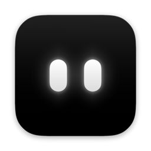
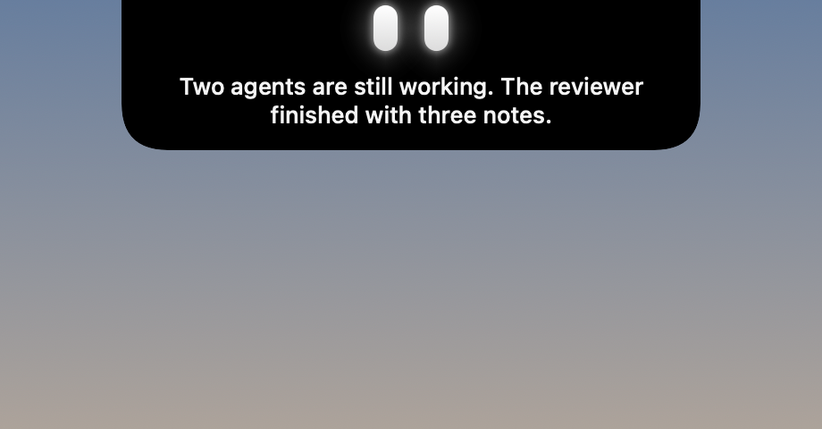
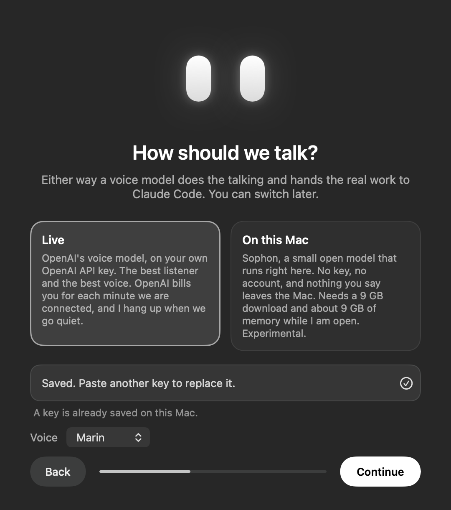

<p align="center">
  
</p>

<h1 align="center">Notch Assistant</h1>

<p align="center">
  A voice in the notch for your coding agents.<br>
  Say its name, ask out loud, and Claude Code does the work and tells you how it went.
</p>

<p align="center">
  
</p>

## What it is

A pair of eyes that lives in the notch of your MacBook. You call it by name
(Jarvis, unless you pick another), it listens, and it answers out loud. It never
does the work itself. It hands every real request to an interactive Claude Code
session on your own subscription, keeps you posted while that runs, and tells
you only what matters from the agents you have going.

| Listening | Asking first |
| --- | --- |
|  |  |
| Say the name, or press Control Option Space. Asleep, nothing leaves the Mac. | When Claude Code needs permission the command shows in the notch and it asks you out loud. |

- **Wakes by name.** The name is recognised on the Mac. A talk key does the same without a word.
- **Talks like a person.** A full duplex voice model takes the turn, so you can cut in and it stops.
- **Delegates everything.** The work runs in Claude Code, on the plan you already have, never the API.
- **Watches your agents.** With [herdr](https://herdr.dev) it sees every agent you have running and starts its own workers.
- **Asks before it acts.** Answer by voice or click. Risky commands take a click.
- **Stays local.** One settings file on your Mac. No database, no account, no server of ours.

## Two voices, your choice



**Live.** OpenAI's `gpt-live-1` on your own API key. The app ships with no key
and never falls back to one. OpenAI bills you by the minute while it is
connected, so it hangs up after 15 seconds of quiet.

**On this Mac.** [Sophon-Realtime](https://github.com/adventists-ai/sophon-realtime),
an open model that runs on Apple silicon. No key and nothing leaves the Mac. It
is a 9 GB download and holds about 9 GB of memory while the app is open, so 16 GB
or more is the sensible floor. Experimental: it answers in about a second and
hands work over reliably, but it is worse than the live voice at ignoring people
talking nearby, and approvals take a click.

<br clear="right">

## What you need

- An Apple silicon Mac on macOS 26 or later
- [Claude Code](https://claude.com/claude-code), installed and signed in
- An OpenAI API key that can use `gpt-live-1`, or no key at all with the voice on this Mac
- Optional: [herdr](https://herdr.dev), so it can start and watch worker agents in their own panes

## Install

Open the disk image and drag Notch Assistant onto Applications. Builds are not
signed with Apple yet, so the first time, open it from Terminal:

```sh
xattr -dr com.apple.quarantine "/Applications/Notch Assistant.app" && open "/Applications/Notch Assistant.app"
```

Setup starts by itself: a name, the voice, the microphone, and the Claude Code
session. You can open it again from the eyes icon in the menu bar.

## Using it

- Say "Jarvis" and talk, or press Control Option Space.
- Talk over it to interrupt. Say "bye" to send it back to sleep.
- Opening the app twice by accident is fine. Only one copy ever runs.

## The herdr plugin

`plugins/herdr` is a [herdr](https://herdr.dev) plugin called `notch-assistant`.
It opens the app when herdr starts, tells it the moment any agent changes state,
and adds an action that hands the focused pane, or the text you selected in it,
to the assistant. Install it with `herdr plugin install nabdulrub/notch-assistant/plugins/herdr`.
See [plugins/herdr](plugins/herdr/README.md).

## Build from source

Needs Xcode 27 or the Swift 6.2 toolchain. There is no Xcode project.

```sh
make run     # build, bundle and launch
make setup   # launch with setup open
make test
make dist    # a disk image in apps/mac/dist to give to someone else
make log     # the last lines of the log
make web     # the landing page on localhost:4321
```

`apps/mac/scripts/dist.sh` signs and notarizes when `SIGN_IDENTITY` and
`NOTARY_PROFILE` are set; otherwise the image is signed ad hoc.

## Contributing

Pull requests are welcome. See [CONTRIBUTING.md](CONTRIBUTING.md) for how changes get in, and
[SECURITY.md](SECURITY.md) for reporting a security problem.

## Where things live

```
apps/mac   the app (SwiftPM)
  Sources/AssistantCore      logic with no UI, covered by the tests
  Sources/Assistant          the notch, the microphone, the voices, setup
  Sources/AssistantChannel   the helper Claude Code runs to talk to the app
  Resources/sophon_bridge.py the bridge to the voice on this Mac
apps/web   the landing page (plain HTML, CSS and one script)
plugins/herdr   the herdr plugin (a manifest and one shell script)
```

Settings, the key and the log live in `~/Library/Application Support/NotchAssistant`.

## License

MIT. See [LICENSE](LICENSE). The bridge to the voice on this Mac includes code
adapted from Sophon-Realtime under the Apache License 2.0; see
[THIRD_PARTY_NOTICES.md](THIRD_PARTY_NOTICES.md).
