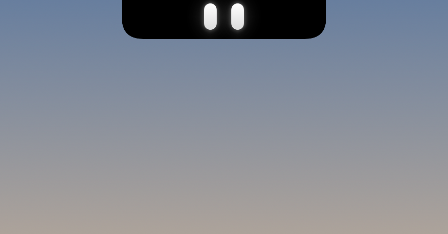
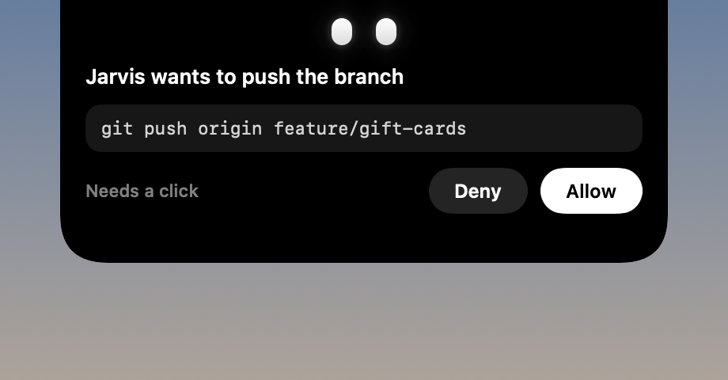

<p align="center">
  
</p>

<h1 align="center">Notch Assistant</h1>

<p align="center">
  A voice in the notch for your coding agents.<br>
  Say its name, ask out loud, and Claude Code does the work and tells you how it went.
</p>

<p align="center">
  
</p>

## What it is

A pair of eyes that lives in the notch of your MacBook. You call it by name
(Jarvis, unless you pick another), it listens, and it answers out loud. It never
does the work itself. It hands every real request to an interactive Claude Code
session on your own subscription, keeps you posted while that runs, and tells
you only what matters from the agents you have going.

| Listening | Asking first |
| --- | --- |
|  |  |
| Say the name, or press Control Option Space. Asleep, nothing leaves the Mac. | When Claude Code needs permission the command shows in the notch and it asks you out loud. |

- **Wakes by name.** The name is recognised on the Mac. A talk key does the same without a word.
- **Talks like a person.** A full duplex voice model takes the turn, so you can cut in and it stops.
- **Delegates everything.** The work runs in Claude Code, on the plan you already have, never the API.
- **Watches your agents.** With [herdr](https://herdr.dev) it sees every agent you have running and starts its own workers.
- **Asks before it acts.** Answer by voice or click. Risky commands take a click.
- **Stays local.** One settings file on your Mac. No database, no account, no server of ours.

## Or no voice at all

Text mode turns the microphone and the voice off. The notch grows a small tab to
its right: an icon for each kind of agent you have open in herdr, Claude, Codex
and the rest, and beside it how many are working right now. When one finishes
or stops to ask you something, the notch says so in a line, for every session
you have running, not only the ones the assistant started.

Press the talk key, or click the tab, and it opens into the list of agents, a
chat you type in and the session's answers. A message goes to the assistant
unless you click an agent first; then it is typed straight into that agent's
pane. Permission requests show the command with Deny and Allow.

Setup asks "Voice or text?" first, and text skips the voice, the key and the
microphone. Settings, General, Mode switches later. It needs no voice model, no
key and no microphone permission.

With no Claude Code session attached, the first message you send starts one in
herdr and is delivered when it is up.

The notch is left out of anything you share or record: on a call nobody sees
which agents you have going or what they said. "Show while sharing my screen" in
Settings puts it back.

## Two voices, your choice


**Live.** OpenAI's `gpt-live-1` on your own API key. The app ships with no key
and never falls back to one. OpenAI bills you by the minute while it is
connected, so it hangs up after 15 seconds of quiet.

**On this Mac.** [Sophon-Realtime](https://github.com/adventists-ai/sophon-realtime),
an open model that runs on Apple silicon. No key and nothing leaves the Mac. It
is a 9 GB download and holds about 9 GB of memory while the app is open, so 16 GB
or more is the sensible floor. Experimental: it answers in about a second and
hands work over reliably, but it is worse than the live voice at ignoring people
talking nearby, and approvals take a click.

<br clear="right">

## What you need

- An Apple silicon Mac on macOS 26 or later
- [Claude Code](https://claude.com/claude-code), installed and signed in
- An OpenAI API key that can use `gpt-live-1`, or no key at all with the voice on this Mac
- Optional: [herdr](https://herdr.dev), so it can start and watch worker agents in their own panes

## Install

Open the disk image and drag Notch Assistant onto Applications. Builds are not
signed with Apple yet, so the first time, open it from Terminal:

```sh
xattr -dr com.apple.quarantine "/Applications/Notch Assistant.app" && open "/Applications/Notch Assistant.app"
```

Setup starts by itself: a name, the voice, the microphone, and the Claude Code
session. You can open it again from the eyes icon in the menu bar.

After that it keeps itself up to date. It looks for a new version every six
hours, downloads it in the background, checks that it was signed with this
project's key, and starts again on it the next time nothing is going on: never
in the middle of a conversation, an open chat, a permission request or a job
the session is running. "Check for Updates" under the eyes icon looks now.
Version 0.1 came before this and has to be replaced by hand once.

## Make it yours

Settings is under the eyes icon in the menu bar, or Command Comma.

- **Delegation.** How much it does itself: nothing, quick looks, or small jobs.
  Which model its workers use for real work and for small jobs, where they run,
  how many at once, and whether it asks before touching agents it did not start.
- **Persona.** Who it is and how it sounds, in your own words. Start from the one
  it ships with, or write your own.
- **Instructions.** Your own rules, added after everything else it is told. Where
  the two clash, yours win.
- **The rest.** Voice or text, its name, the talk key, the session folder, the
  voice, how often it speaks up while agents work, and whether a shared screen
  shows the notch.

A session that is already running is sent its new instructions when you save, so
there is nothing to start again. The model the session itself runs on changes
the next time it starts.

## Using it

- Say "Jarvis" and talk, or press Control Option Space.
- Talk over it to interrupt. Say "bye" to send it back to sleep.
- With the voice on this Mac, a cough or a noise does not lose what it was telling you: it stops, waits to see whether you ask for something, and if you do not, picks the line back up. Click the notch to stop it completely.
- With the voice on this Mac it can listen only to you. It learns the voice that says its name with a request, and takes anyone else, a television or a long noise for the room. This needs one more file, about 27 MB: [`voxceleb_resnet34_LM.onnx`](https://huggingface.co/Wespeaker/wespeaker-voxceleb-resnet34-LM) (WeSpeaker, CC BY 4.0) in `models/speaker/` next to Sophon's `app` folder, and `onnxruntime` in Sophon's Python environment. Without them every voice is heard, as before. "Only my voice" in Settings turns it off.
- Or send it away without a word: click the notch, press the talk key again, or pick "Send to Sleep" from the eyes icon in the menu bar.
- Ask about what is on your screen: "what's this error", "look at this". It takes one picture of the display your pointer is on, the notch says "Looking at your screen" while it does, and nothing is kept. macOS asks once for Screen Recording; it never looks unless you ask.
- Opening the app twice by accident is fine. Only one copy ever runs.

## The herdr plugin

`plugins/herdr` is a [herdr](https://herdr.dev) plugin called `notch-assistant`.
It opens the app when herdr starts, tells it the moment any agent changes state,
and adds an action that hands the focused pane, or the text you selected in it,
to the assistant. Install it with `herdr plugin install nabdulrub/notch-assistant/plugins/herdr`.
See [plugins/herdr](plugins/herdr/README.md).

## Build from source

Needs Xcode 27 or the Swift 6.2 toolchain. There is no Xcode project.

```sh
make run     # build, bundle and launch
make setup   # launch with setup open
make test
make dist    # a disk image in apps/mac/dist to give to someone else
make release # the disk image signed for the updater, and the feed that announces it
make log     # the last lines of the log
make web     # the landing page on localhost:4321
```

`apps/mac/scripts/dist.sh` signs and notarizes when `SIGN_IDENTITY` and
`NOTARY_PROFILE` are set; otherwise the image is signed ad hoc.

### Releasing

Updates are fetched and installed by [Sparkle](https://sparkle-project.org).
Every copy reads `appcast.xml` from the latest GitHub release and only installs
a disk image signed with the private half of `apps/mac/Resources/update-key.pub`.

1. Put the new version in `apps/mac/VERSION` and merge it.
2. On `main`, run `make release`. It builds the image, signs it with the key in
   the login keychain, writes `dist/appcast.xml` and prints the command that
   publishes both.
3. Run that command. Copies in use pick the release up within six hours.

The private key is in the login keychain of the Mac releases are made on, under
the account `notch-assistant`. Keep a copy of it somewhere safe: installed
copies never accept an update signed with another key, so a lost key means
everyone installs the next version by hand. `apps/mac/scripts/release.sh` says
how to export it.

A build made by `make run` has no feed and never replaces itself; only the
disk images do. To try the updater against a feed of your own, `FEED_URL`,
`UPDATE_KEY`, `BUNDLE_ID`, `VERSION` and `BUILD_NUMBER` override what
`scripts/bundle.sh` writes into the bundle.

## Contributing

Pull requests are welcome. See [CONTRIBUTING.md](CONTRIBUTING.md) for how changes get in, and
[SECURITY.md](SECURITY.md) for reporting a security problem.

## Where things live

```
apps/mac   the app (SwiftPM)
  Sources/AssistantCore      logic with no UI, covered by the tests
  Sources/Assistant          the notch, the microphone, the voices, setup
  Sources/AssistantChannel   the helper Claude Code runs to talk to the app
  Resources/sophon_bridge.py the bridge to the voice on this Mac
apps/web   the landing page (plain HTML, CSS and one script)
plugins/herdr   the herdr plugin (a manifest and one shell script)
```

Settings, the key and the log live in `~/Library/Application Support/NotchAssistant`.

## License

MIT. See [LICENSE](LICENSE). The bridge to the voice on this Mac includes code
adapted from Sophon-Realtime under the Apache License 2.0; see
[THIRD_PARTY_NOTICES.md](THIRD_PARTY_NOTICES.md).
